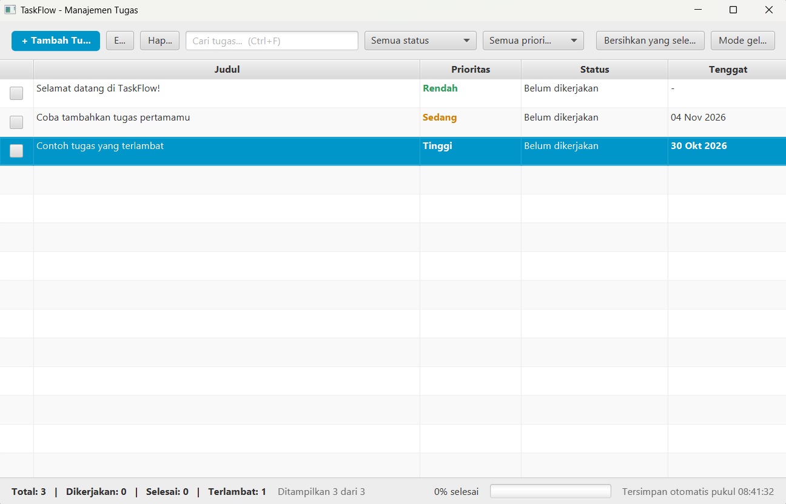

# TaskFlow

[](https://github.com/Oliver-ist/taskflow-javafx/actions/workflows/build.yml)


**TaskFlow** adalah aplikasi desktop manajemen tugas (to-do) berbasis **JavaFX**.
Data tugas disimpan otomatis ke file JSON di komputer, sehingga tidak hilang saat aplikasi ditutup.
Project ini cocok sebagai contoh belajar JavaFX yang sedikit lebih lengkap dari "hello world":
ada tabel, dialog, pencarian, filter, penyimpanan data, tema gelap, dan unit test.

<!--
Setelah aplikasi dijalankan, ambil screenshot, simpan sebagai docs/screenshot.png,
lalu hapus tanda komentar pada baris di bawah ini.

## Tampilan

-->

## Fitur

- Tambah, edit, dan hapus tugas (judul, deskripsi, prioritas, status, tenggat)
- Tabel yang bisa diurutkan dengan klik pada judul kolom
- Pencarian cepat pada judul dan deskripsi, serta filter berdasarkan status dan prioritas
- Centang kotak pada baris untuk menandai tugas selesai
- Penanda visual: prioritas berwarna, tenggat terlambat berwarna merah, tugas selesai dibuat pudar
- Statistik dan progress bar (total, sedang dikerjakan, selesai, terlambat)
- Penyimpanan otomatis ke `~/.taskflow/tasks.json`
- Mode gelap (pilihan tersimpan dan diingat saat aplikasi dibuka lagi)
- Menu klik-kanan dan pintasan keyboard

### Pintasan keyboard

| Pintasan                | Fungsi                      |
|-------------------------|-----------------------------|
| `Ctrl` + `N` (`Cmd` di macOS) | Tambah tugas baru     |
| `Ctrl` + `E`            | Edit tugas terpilih         |
| `Ctrl` + `F`            | Fokus ke kolom pencarian    |
| `Delete`                | Hapus tugas terpilih        |
| Klik dua kali pada baris | Edit tugas                 |

## Teknologi

- Java 21
- JavaFX 21 (`javafx-controls`)
- Maven (+ `javafx-maven-plugin`)
- Gson untuk penyimpanan JSON
- JUnit 5 untuk unit test
- GitHub Actions untuk build otomatis

## Prasyarat

1. **JDK 21 atau lebih baru** (cek dengan `java -version`)
2. **Apache Maven 3.9+** (cek dengan `mvn -version`)

JavaFX tidak perlu dipasang manual karena diunduh otomatis oleh Maven.

## Cara menjalankan

```bash
# 1. Clone repository
git clone https://github.com/Oliver-ist/taskflow-javafx.git
cd taskflow-javafx

# 2. Jalankan aplikasi
mvn javafx:run
```

Saat pertama kali dijalankan, Maven akan mengunduh dependensi sehingga prosesnya agak lama.
Pada pembukaan pertama, aplikasi menampilkan tiga tugas contoh.

### Menjalankan test

```bash
mvn verify
```

### Membuka di IDE

Impor sebagai **Maven project** di IntelliJ IDEA, Eclipse, atau VS Code (Extension Pack for Java).
Untuk menjalankan, gunakan Maven goal `javafx:run` (jangan menjalankan `App.main` langsung
tanpa konfigurasi module path JavaFX).

## Struktur project

```
taskflow-javafx/
├── pom.xml
├── README.md
├── LICENSE
├── .gitignore
├── .github/workflows/build.yml        # CI: build + test otomatis di GitHub
└── src/
    ├── main/
    │   ├── java/com/taskflow/
    │   │   ├── App.java               # titik masuk aplikasi
    │   │   ├── model/
    │   │   │   ├── Task.java          # model tugas (JavaFX properties)
    │   │   │   ├── Priority.java      # enum prioritas
    │   │   │   └── Status.java        # enum status
    │   │   ├── storage/
    │   │   │   └── TaskRepository.java  # baca/tulis JSON
    │   │   └── ui/
    │   │       ├── MainView.java      # tampilan utama (toolbar, tabel, status bar)
    │   │       ├── TaskDialog.java    # dialog tambah/edit tugas
    │   │       └── DialogUtil.java    # helper dialog (konfirmasi, error, tema)
    │   └── resources/com/taskflow/
    │       └── styles.css             # tema terang dan gelap
    └── test/java/com/taskflow/
        ├── model/TaskTest.java
        └── storage/TaskRepositoryTest.java
```

## Cara kerja singkat

- **Model** (`Task`) memakai JavaFX properties, sehingga `TableView` otomatis ikut berubah
  ketika data berubah.
- **Daftar tugas** berupa `ObservableList` yang dibungkus `FilteredList` (pencarian dan filter)
  lalu `SortedList` (pengurutan kolom).
- **Penyimpanan** dilakukan setiap ada perubahan dengan jeda singkat (debounce 400 ms) dan saat
  aplikasi ditutup. File ditulis ke berkas sementara lebih dulu lalu dipindahkan, supaya data
  tidak rusak bila aplikasi terhenti di tengah proses menyimpan.
- **Lokasi data**: `~/.taskflow/tasks.json` (misalnya `C:\Users\Nama\.taskflow\tasks.json` di Windows).
  Hapus file ini untuk mengembalikan aplikasi ke kondisi awal.

## Pemecahan masalah

| Masalah | Solusi |
|---------|--------|
| `release version 21 not supported` | JDK yang aktif di Maven lebih lama dari 21. Pasang JDK 21 dan atur `JAVA_HOME`. |
| `JavaFX runtime components are missing` | Jalankan dengan `mvn javafx:run`, bukan `java -jar` atau `App.main` langsung. |
| Jendela tidak muncul di Linux server/WSL | JavaFX membutuhkan lingkungan grafis (X11/Wayland). Di WSL gunakan WSLg atau X server. |

## Ide pengembangan

- [ ] Kategori atau label tugas
- [ ] Pengingat saat tenggat mendekat
- [ ] Ekspor dan impor CSV
- [ ] Undo/redo
- [ ] Paket installer dengan `jpackage`

## Kontribusi

Pull request dan issue sangat diterima.

1. Fork repository ini
2. Buat branch fitur: `git checkout -b fitur/nama-fitur`
3. Commit perubahan: `git commit -m "Tambah fitur X"`
4. Push branch: `git push origin fitur/nama-fitur`
5. Buka Pull Request

## Lisensi

Dirilis di bawah lisensi [MIT](LICENSE).
